# SO-ELL: Ebook practice and midterm performance

<div class="subtitle">Design report: what was built, how, and why. Written so that someone new can run the project, defend every result, and take ownership of it.<br>Michigan Data Science Team (MDST) · Runestone interactive ebook logs, SI 206 / SI 201 · October 2026</div>

[TOC]

## 1. Summary

**Question.** Students in the intermediate Python course practice in a Runestone interactive ebook. Which kinds of practice line up with how they do on the midterms, and can that practice flag struggling students before the exam?

**Data.** 19.8 million logged ebook events from 13 exports covering 10 semesters, of which 8 semesters (Fall 2021 to Fall 2025) have usable activity. There are 1,397 students, 2,745 reconstructed midterm scores and 16 midterms. The data are student activity logs shared with us by the course for this project, so **raw and student-level data never leave the analysis machine**. The repository contains the code, the executed notebooks and aggregate results only.

**Headline results.**

| Finding | Number |
|---|---|
| Students in the top quarter of *first-try Parsons success* score higher than the bottom quarter of the same semester and exam | **+20.4 exam points** (95% CI 18.8–22.1) |
| Same relationship as a regression with cohort fixed effects and student-clustered errors | **+4.9 points per 10 Parsons points**, 5.0 with effort controls |
| Same, midterm 2 only, holding the student's own midterm 1 score fixed | **+1.6 points per 10** (smaller but clearly non-zero) |
| How much practice a student did | active days 0.02; total events -0.14 (more attempts often means more struggle) |
| At-risk model (bottom quarter of cohort), tested on a semester it never saw | AUC **0.78** (logistic), precision **57%** among the 10% flagged (base rate 25%) |
| Same model, two weeks before the exam | AUC **0.71** |
| For midterm 2, midterm 1 score alone | AUC 0.82; adding practice features: 0.83 |

**What to take away.** The quality of a student's first attempts at Parsons problems (drag-the-lines-into-order code puzzles) is the strongest and most robust practice signal of exam performance in this data. It holds within every cohort, with effort controls, with the student's own earlier exam held fixed, and under every answer-key scoring threshold tried. The amount of practice matters far less. Practice data can flag at-risk students weeks ahead with useful accuracy, but once a midterm 1 score exists it carries most of the information about midterm 2. All of this is association, not causation (§9).

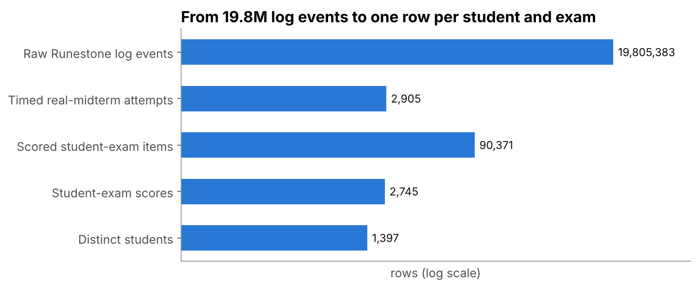
<em class="caption">Figure 1. From raw log rows to scored student-exams.</em>

<h2 class="newpage" id="2-the-data">2. The question and the data</h2>

### 2.1 Where the data come from

[Runestone Academy](https://runestone.academy) hosts the course's interactive textbook. Every interaction a logged-in student makes (opening a page, running code, answering a multiple-choice question, submitting a Parsons puzzle, starting a timed exam) is written to a log. The instructor exports it in the **Datashop** tab-separated format, one file per semester (and, from Fall 2023 on, one file per lecture section, MW and TTh).

Each row is one event. The columns that matter:

| Column | Meaning |
|---|---|
| `Anon Student Id` | anonymized student number, **local to the export file** (§4.1) |
| `Session Id` | browser session, also local to the file |
| `Time` | timestamp |
| `Selection` | the kind of component (`mChoice`, `parsons`, `unittest`, `fillb`, `timedExam`, `page`, …) |
| `Action` | what happened, often with the result embedded (e.g. `correct:2:...`, `start`, `finish`, `percent:0.8`) |
| `Input` | the student's answer text for fill-in and drag-and-drop items |
| `Problem Name` | the component's id (e.g. `mid1_timed_q3`, `ch10_parsons_4`) |
| `Level (Chapter)` | the ebook chapter |

### 2.2 What is *not* in the data

There is **no gradebook**. Midterms are taken inside the ebook as timed exams, so the score has to be rebuilt from the answer events inside each student's exam window (§5.3). There is also no demographic or prior-GPA information, which limits what the analysis can control for.

### 2.3 Semesters

| Semester | Files | Analysis |
|---|---|---|
| F21, W22, F22, W23, W24 | one combined export each | included |
| F23, F24, F25 | separate MW and TTh exports | included, ids namespaced by section |
| W20, W21 | one export each with 404 and 5 rows | excluded: no timed exams and almost no activity logged |

### 2.4 Sensitivity and what is published

The logs are pseudonymous but behavioral, and they were shared for this project only. The rule the repository follows: **anything with one row per student stays on the analysis machine**. Concretely, `data/raw/**`, `data/interim/` and `data/processed/` are git-ignored. Committed: code, `data/raw/MANIFEST.csv` (file names, sizes and SHA-256 checksums), executed notebooks (which display only counts, means and quantiles), and `outputs/` (cohort-level tables and figures). The inferred answer keys are exported without the keys themselves.

<h2 class="newpage" id="3-architecture">3. Architecture</h2>

### 3.1 The shape of the pipeline

```
data/raw/<SEM>/*.gz|zip|bz2   (13 files, checksummed in MANIFEST.csv)
        │  01 ingest        verify checksums, normalize columns, namespace ids
        ▼
data/interim/events.parquet   (19.8M rows, sorted, zstd)
        │  02 exam windows  which timed exam is the real midterm; start/finish per student
        ▼
data/interim/exam_attempts.parquet
        │  03 scoring       rebuild each student's midterm score from in-window answers
        ▼
data/processed/student_exam_scores.parquet
        │  04 features      pre-exam practice summaries (pandas + DuckDB SQL), leakage-guarded
        ▼
data/processed/student_exam_features[_cutoff_Nd].parquet
        │  05 analysis      within-cohort correlations, FDR, bootstrap, fixed effects, sensitivity
        │  06 models        at-risk classifiers, leave-one-semester-out, lead-time curve, MLflow
        │  07 report        practice exams, cramming, figures, headline metrics, Looker export
        ▼
outputs/{tables,figures,looker_studio,data_quality}/   (aggregates only: safe to commit)
```

Every stage reads the previous stage's files from disk and writes its own. That makes each stage restartable on its own, makes the intermediate data inspectable, and lets three different runners drive the same code.

### 3.2 Three ways to run the same code

| Runner | Command | When to use it |
|---|---|---|
| **Notebooks** | `make notebooks` | The canonical, readable run. Each notebook runs one stage step by step, prints the source of every function and SQL file just before it runs, and shows aggregate results in between. A reader can scroll through and see every line of code that produced the results without having the data. |
| **CLI** | `uv run so-ell all` (or `so-ell features`, `so-ell all --from analysis`, …) | Fast headless re-runs while developing. |
| **Dagster** | `make dagster` | The same stages as software-defined assets with lineage, a UI and per-asset re-materialization. |

All three call the functions in `src/so_ell/`. The notebooks are not a separate copy of the logic: they import it and display it with `so_ell.notebook.show()`, which renders `inspect.getsource()` of the function. That gives readable notebooks and a single tested source of truth at the same time; logic that lives only in notebooks can't be unit-tested and drifts.

### 3.3 Repository map

| Path | What it holds |
|---|---|
| `src/so_ell/config.py` | every path, the semester list, thresholds and the random seed |
| `src/so_ell/ingest.py` | manifest, checksums, reading exports, id namespacing, DuckDB write |
| `src/so_ell/exam_windows.py` | real-midterm detection, attempt windows, name audit |
| `src/so_ell/scoring.py`, `scores.py` | answer parsers; exam score reconstruction and answer-key inference |
| `src/so_ell/features.py`, `sql_features.py`, `sql/*.sql` | practice features (pandas and DuckDB) |
| `src/so_ell/stats.py` | within-cohort statistics, FDR, bootstrap, fixed-effects models |
| `src/so_ell/models.py` | at-risk models, validation, calibration, lead time, MLflow logging |
| `src/so_ell/practice_exams.py` | timed practice exams and cramming |
| `src/so_ell/report.py` | figures, headline metrics, Looker tables |
| `src/so_ell/validation.py` | Pandera schemas and SQL data-quality checks |
| `src/so_ell/pipeline.py`, `cli.py`, `orchestration.py` | stage functions, CLI, Dagster assets |
| `notebooks/01–07` | the executed build walkthrough (generated by `notebooks/build_notebooks.py`) |
| `app/streamlit_app.py` | interactive dashboard over `outputs/` |
| `tests/` | unit tests and a synthetic end-to-end test |
| `docs/` | this report, its source and builder, the feature dictionary |

<h2 class="newpage" id="4-data-problems-found-and-fixed">4. Data problems found and fixed</h2>

This section is the most important one for anyone who inherits the project, because each of these silently changed results in the first version.

### 4.1 Student ids collide across section exports

From Fall 2023 the MW and TTh sections are exported as separate files, and **each file numbers its students from 1**. Version 1 keyed students on `(semester, Anon Student Id)`, so "student 5" in MW and "student 5" in TTh became one person: their events were pooled, their exam windows were mixed, and their scores were computed over both students' answers. Notebook 01 counts the local ids that started the real midterm in *both* section files of the same semester: 59 in F23 and 87 in F25. Each of those would have been two students scored as one, and many more ids were shared without both students taking the exam.

**Fix.** Ids are rebuilt at ingest as `<semester>-<section>-<local id>` (e.g. `F25-MW-0005`); session ids get the same prefix. A Pandera regex check (`^(F|W)\d{2}-(ALL|MW|TTh)-\d{4}$`) enforces the format downstream, and the end-to-end test builds two synthetic sections that share local ids and asserts they stay separate.

### 4.2 The same mechanism logs real midterms, practice midterms and quizzes

`timedExam` start/finish markers are written for every timed assessment. Names like `Midterm 1 Practice (timed)` or `pi_mid1_review` would otherwise be taken for the real exam.

**Fix.** A name is a real midterm when it parses as midterm 1 or 2 *and* contains none of the words `practice`, `post`, `quiz`, `study`, `intro`, `pi*` (`exam_windows.is_real_exam_name`). Every timed-exam name with its decision and student count is written to `outputs/tables/exam_name_audit.csv`, so the rule can be checked by eye. The pipeline also fails if any semester is missing either midterm.

### 4.3 Midterm 1 answers leaked into midterm 2 "practice"

Features for midterm 2 used every event before the midterm 2 start. That includes the answers the student typed *during midterm 1*, which makes the midterm 1 score part of the midterm 2 features. In the SQL feature path this was easy to miss because the filter was a plain `time < exam_start`.

**Fix.** Both feature paths first remove every event inside *any* of the student's exam windows (pandas: `features.drop_exam_window_events`; SQL: a `NOT EXISTS` anti-join in `sql/04_pre_exam_events.sql`), then apply `time < exam_start - cutoff`. The end-to-end test plants answers inside a synthetic midterm 1 window and asserts that both paths count only the two real practice problems for midterm 2.

### 4.4 Near-empty semesters

W20 and W21 have 404 and 5 rows. They are ingested (so the manifest is complete and row counts are reported) and excluded via `config.EXCLUDED_SEMESTERS`.

### 4.5 "Leave one semester out" wasn't

Version 1 described its model validation as leave-one-semester-out but used `GroupKFold(5)`, which puts several semesters in each test fold. The models now use `LeaveOneGroupOut` on semester, so each fold trains on 7 semesters and predicts the 8th.

<h2 class="newpage" id="5-stage-by-stage">5. How each stage is built, and why</h2>

### 5.1 Ingest (notebook 01, `ingest.py`)

- **Compressed raw files are canonical.** They are what the course staff sent; uncompressed copies are a convenience and are not read.
- **Checksums.** `MANIFEST.csv` stores the SHA-256 of every file. Ingest refuses to run if a file is missing or changed (`--skip-checksums` exists for development only). A result is therefore tied to exact bytes.
- **Read everything as text.** Columns drift between exports (names, casing, extra columns). `standardize_columns` maps them to one canonical set, and reading with `dtype=str` avoids pandas guessing types differently per file (e.g. ids with leading zeros).
- **One sorted parquet, written by DuckDB.** Each file becomes a parquet part; DuckDB concatenates and sorts by semester, student and time, compressed with zstd. Sorting makes per-student scans and window joins fast, and 19.8M rows fit in about 190 MB instead of several GB of CSV.
- **Checks.** `validation.event_log_checks` runs SQL on the result. Hard checks (they fail the run): no null student ids, every id in the namespaced format, no null selection. Soft checks (reported in `outputs/data_quality/event_log_checks.csv`, because the raw exports legitimately contain a few such rows): unparseable timestamps, timestamps outside 2019–2026, exact duplicate rows, and events more than 60 days outside a semester's normal date range.

### 5.2 Exam windows (notebook 02, `exam_windows.py`)

- Markers are loaded with DuckDB, reading only `timedExam` rows.
- An **attempt** is `(semester, student, session, midterm)`, from the earliest start to the latest finish. A missing finish means the window is just the start; a finish logged before the start (an earlier session's) is ignored.
- A student's **window** for a midterm spans all their attempts at it (`scores.build_windows`). Result: 2,905 attempts and 2,780 student-exam windows across 16 exams, none missing; 2,745 of those windows contain at least one scoreable answer and get a score.

### 5.3 Score reconstruction (notebook 03, `scoring.py`, `scores.py`)

The midterm score is the mean score over the scoreable items a student answered inside their window.

| Item type | Rule | Why |
|---|---|---|
| multiple choice | last answer | the exam grades the final submission |
| Parsons | best attempt; opened but never submitted = 0 | Parsons can be re-checked; an unsubmitted item earns nothing |
| ActiveCode | best unit-test pass rate; never run = 0 | same logic |
| fill-in, clickable, drag-and-drop | last answer vs an inferred key | these events don't log correctness |
| short answer | excluded, counted in `unscored_items_summary.csv` | hand-graded, nothing to compare to |

**Inferred answer keys.** For each keyed problem, the key is the most common final answer, used only if at least 65% of students agree (`KEY_CONFIDENCE_THRESHOLD`). The idea: on a midterm, most students get most items right, so a strong majority answer is the correct one; when there is no strong majority the item is left unscored rather than guessed. Because this is an assumption, notebook 05 re-runs the headline at thresholds 55%, 65%, 75%, 85% and with inferred keys dropped entirely (§8.3).

**Memory.** Only answer selections are loaded (16.8M of the 19.8M rows; page views and navigation are skipped), and the large `action` / `input` text columns are kept only for the selections whose parser needs them. That keeps the scoring stage around 3 GB.

### 5.4 Practice features (notebook 04, `features.py`, `sql/`)

One row per student × midterm, computed only from practice before that exam (§4.3 for the guards). Two engines:

- **pandas** builds per-problem quality: for each problem, the first scored attempt, last, best, the gain from first to last, and attempts per problem; then means per family (`parsons__mean_first_score` is the headline feature). Vectorized `groupby` first/last/max instead of a per-group Python function: the difference was minutes vs. hours.
- **DuckDB SQL** builds coverage (chapters, subchapters, families, chapter diversity as 1 − Herfindahl), consistency (active days, sessions, weeks, span) and timing (events and share in the last 3/7/14/28 days). SQL is the natural language for these windowed counts over 19.8M rows, and DuckDB runs it in-process on the parquet with no server.

Counts are filled with 0 (no practice = zero events), while quality metrics stay missing when there is nothing to average; tree models handle the missing values natively and the logistic model imputes the median inside its pipeline. Full definitions: `docs/feature_dictionary.md`.

**Lead-time variants.** The same code runs with `cutoff_days` = 3, 7, 14, 21 and 28, producing one feature file per cutoff for the early-warning curve. In SQL the cutoff is passed as a DuckDB variable (`getvariable('cutoff_days')`) so there is one query, not six.

### 5.5 Analysis (notebook 05, `stats.py`)

See §7 for the statistical reasoning. The stage writes `feature_signals.csv` (every feature's within-cohort correlation, quartile gap, p and q value), `parsons_models.csv`, `parsons_gap_bootstrap.csv`, quartile tables, mid1→mid2 change tables and `key_threshold_sensitivity.csv`.

### 5.6 Models (notebook 06, `models.py`)

- **Target.** Bottom 25% of the student's own cohort. A fixed cutoff like "below 60%" would make the target mostly about which semester had the harder exam.
- **Validation.** Leave one semester out. This is how the model would be used (train on past terms, score the current one) and it tests whether the signal transfers across instructors, exam versions and cohorts. Random K-fold would leak semester-specific patterns between train and test.
- **Models.** L2-regularized logistic regression on standardized features (interpretable, a strong baseline on 10 features) and a shallow histogram gradient-boosted tree (captures nonlinearity and missing values). Ten features chosen to cover quality, volume, coverage, timing, consistency and mix without near-duplicates.
- **Metrics.** ROC AUC (ranking), average precision (the positive class is 25%), Brier score (probability quality), precision among the top 10% flagged (what an instructor reaching out to 10% of the class would see), plus a calibration table and permutation importance.
- **Prior-ability comparison.** For midterm 2: midterm 1 score alone, practice alone, and both.
- **Tracking.** Every run is logged to MLflow (sqlite backend in `mlruns/`) with parameters, metrics, per-semester AUC and importance tables.

### 5.7 Report (notebook 07, `practice_exams.py`, `report.py`)

Timed practice exams (finished one / started only / none) and cramming (share of the last 28 days of practice in each window before the exam) are analyzed here, then every figure, `outputs/headline_metrics.csv` and the Looker Studio tables are written. Figures use one palette throughout: blue for midterm 1, orange for midterm 2, gray for context.

<h2 class="newpage" id="6-validation-and-testing">6. Validation and testing</h2>

| Layer | What it catches | Where |
|---|---|---|
| Checksums | a raw file changed or is missing | `ingest.run_ingest` |
| SQL checks on the event log | null or malformed ids (hard); unparsed or out-of-range times, duplicates (soft) | `validation.event_log_checks` |
| Pandera schemas | wrong types, ranges (scores 0–100), id format, duplicate keys in attempts, scores and features | `validation.py`, called at the end of each stage |
| Pipeline assertions | a semester missing a midterm | `stage_exam_windows` |
| Unit tests | parsers, real-exam name rule, statistics helpers | `tests/test_scoring.py`, `test_exam_windows.py`, `test_stats.py` |
| End-to-end test | runs ingest → windows → scores → features on a synthetic two-section semester; asserts id namespacing, practice-exam exclusion, exact scores, no mid1→mid2 leak in either feature engine | `tests/test_pipeline_end_to_end.py` |
| CI | lint (ruff) and all tests on every push, from the locked environment | `.github/workflows/ci.yml` |

The end-to-end test is what makes the project checkable by someone without the data: CI runs the real pipeline code on fabricated exports that reproduce each failure mode in §4.

<h2 class="newpage" id="7-statistical-approach">7. Statistical approach</h2>

### 7.1 Compare within cohorts

Mean midterm scores range widely across semesters and exams (Figure 2): exams change, instructors change, the ebook changes. Pooling all students would mostly measure which semester someone took the course in. So every comparison is made **within a cohort** (semester × midterm, 16 cohorts): ranks are computed within cohort, quartiles are within-cohort quartiles, and regressions include cohort fixed effects.

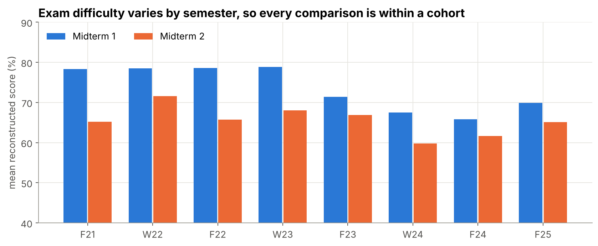
<em class="caption">Figure 2. Reconstructed midterm scores by cohort.</em>

### 7.2 Screen many features, control the false discovery rate

116 features are screened. For each: feature and score are converted to percentile ranks *within each cohort* and correlated (a pooled Spearman correlation); the gap in mean exam score between the top and bottom within-cohort quarter of the feature; and a p-value from the usual t-approximation. With that many tests, a handful would look "significant" by chance, so Benjamini–Hochberg q-values are reported and only q < 0.05 is treated as a signal.

### 7.3 Quantify the headline with honest uncertainty

- **Quartile gap with a cluster bootstrap.** Each student contributes up to two rows (two midterms), which are not independent. The bootstrap therefore resamples *students* with replacement (1,000 draws), recomputes the within-cohort gap, and takes the 2.5th–97.5th percentiles.
- **Fixed-effects regressions.** `score ~ parsons_first + C(cohort)`, with standard errors clustered by student; then adding effort controls (log events, active days, chapters, last-week share); then midterm 2 only with the student's own midterm 1 score as a control. The third is the closest the data gets to asking "is it the practice, or just a stronger student?": it compares students who did equally well on midterm 1.
- **Sensitivity to scoring assumptions.** The headline is recomputed after re-scoring every exam under five answer-key thresholds.

<h2 class="newpage" id="8-results">8. Results</h2>

### 8.1 Volume vs quality

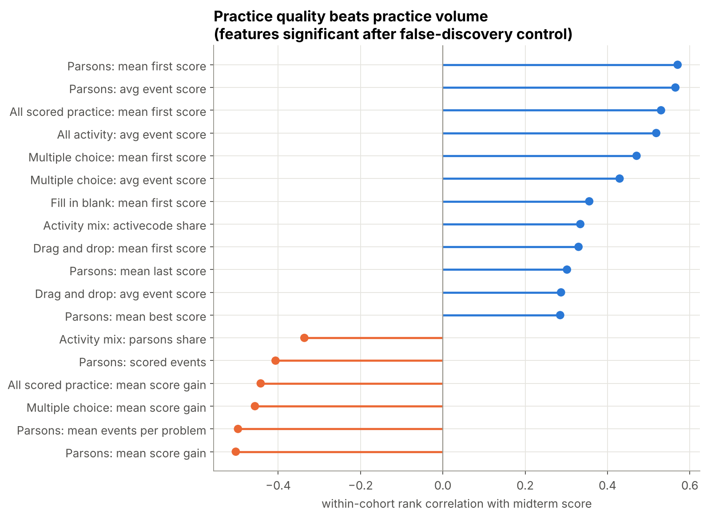
<em class="caption">Figure 3. Strongest within-cohort correlations with midterm score.</em>

94 of 116 features are significant after FDR control, but the strongest are about *quality of first attempts* (Parsons first try 0.57, multiple-choice first try, ActiveCode best score), not about *how much* a student practiced. Active days barely correlate (0.02), and total events correlate *negatively* (-0.14): many events per problem usually means many wrong checks, which is a sign of struggle rather than diligence.

### 8.2 The Parsons signal

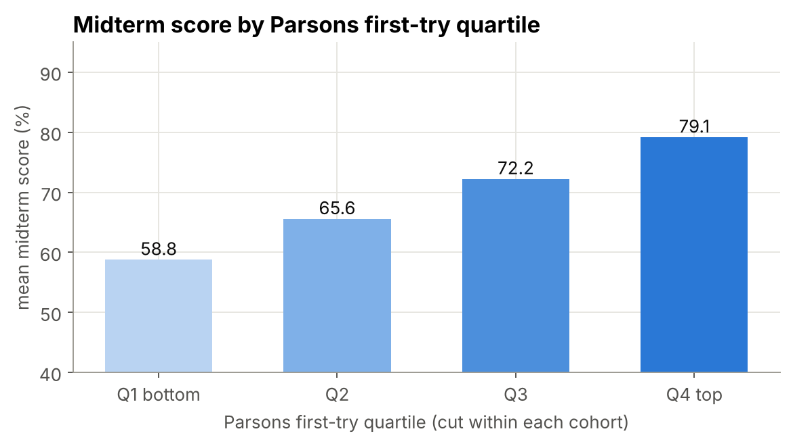
<em class="caption">Figure 4. Midterm score by within-cohort quartile of first-try Parsons success.</em>

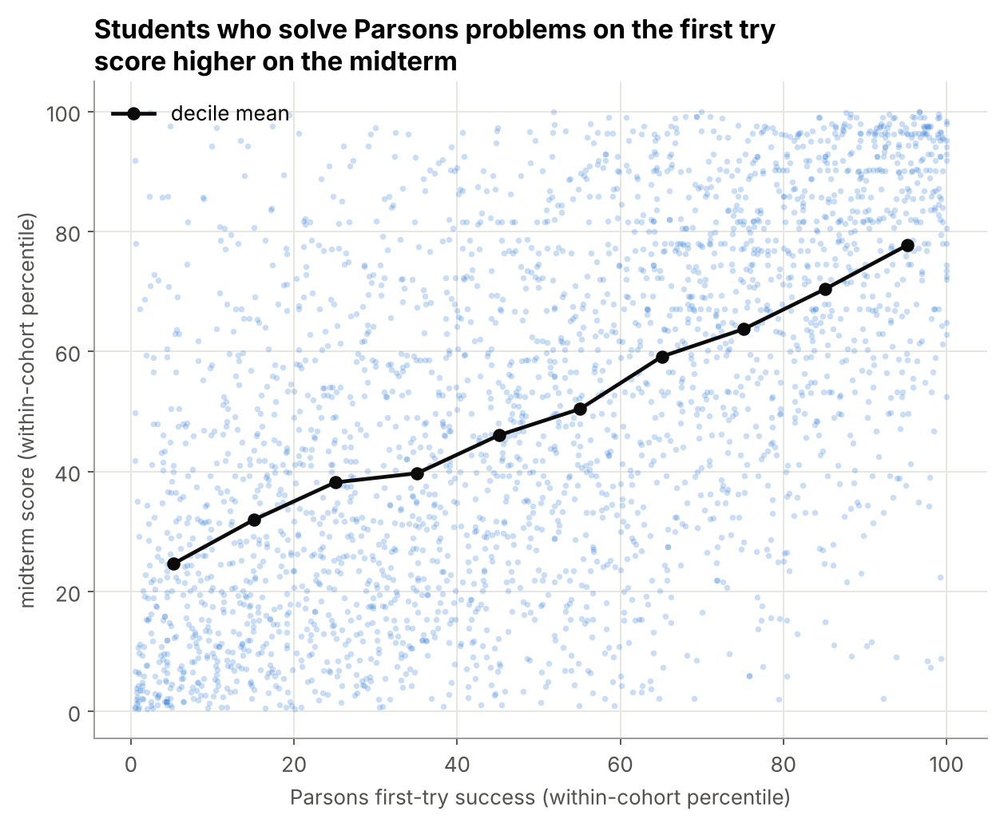
<em class="caption">Figure 5. Within-cohort percentiles, every student-exam.</em>

| Specification | n | Points per 10 Parsons points | 95% CI |
|---|---|---|---|
| Cohort fixed effects | 2,739 | 4.87 | 4.49 to 5.24 |
| + effort controls | 2,739 | 4.96 | 4.56 to 5.36 |
| Midterm 2, controlling for midterm 1 | 1,346 | 1.62 | 1.15 to 2.09 |

### 8.3 Robustness to the answer-key assumption

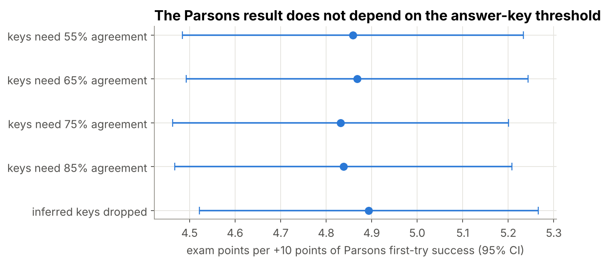
<em class="caption">Figure 6. Headline coefficient under each answer-key threshold.</em>

The quartile gap stays between 20.3 and 20.5 points across all thresholds, including dropping inferred keys entirely, so the result does not depend on how fill-in and drag-and-drop items are scored.

### 8.4 The "gain paradox"

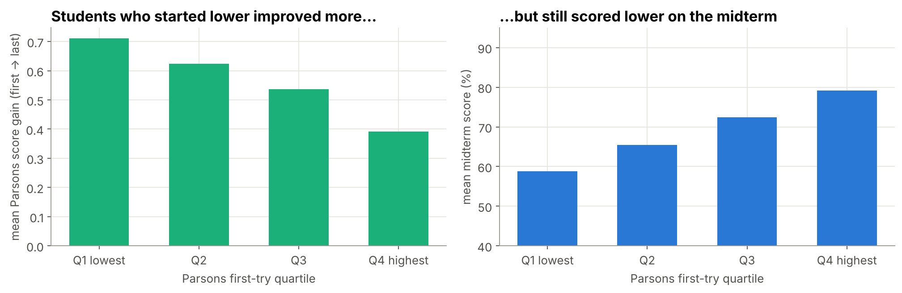
<em class="caption">Figure 7. Improvement from first to last attempt, by first-try quartile.</em>

Improvement on Parsons problems (last minus first attempt) correlates *negatively* with exam score. This is a ceiling effect, not evidence that improving is bad: students who get a problem right the first time have no room to improve, and students who start low have the most. The table shows it directly: from the bottom to the top first-try quartile, average Parsons gain falls from 0.71 to 0.39 while the mean exam score rises from 59 to 79. It is a good example of why the report leads with first-try quality rather than gain.

### 8.5 Timing and timed practice exams

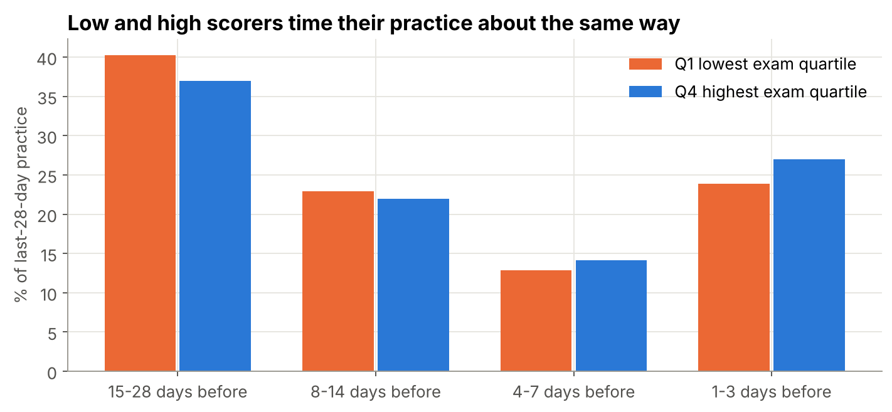
<em class="caption">Figure 8. When in the last 28 days practice happened, by exam score group.</em>

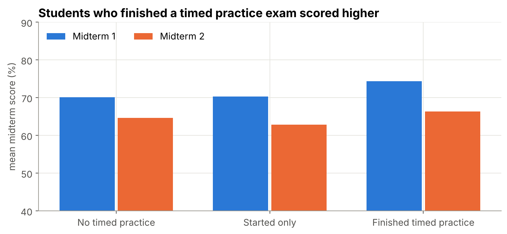
<em class="caption">Figure 9. Midterm scores by timed practice exam use.</em>

Timing barely differs by score group. Every quarter of the class does about 37–41% of its last-four-week practice in the final week, and the lowest-scoring quarter actually does slightly *less* in the final three days (24% vs 27%). Nothing here suggests cramming is what separates low scorers. Students who finished a timed practice midterm scored 5.2 points higher than students in the same cohort who did none, and the best practice-exam score correlates 0.32 with the real score. Self-selection is strong here: motivated students both take practice exams and do well.

### 8.6 At-risk models

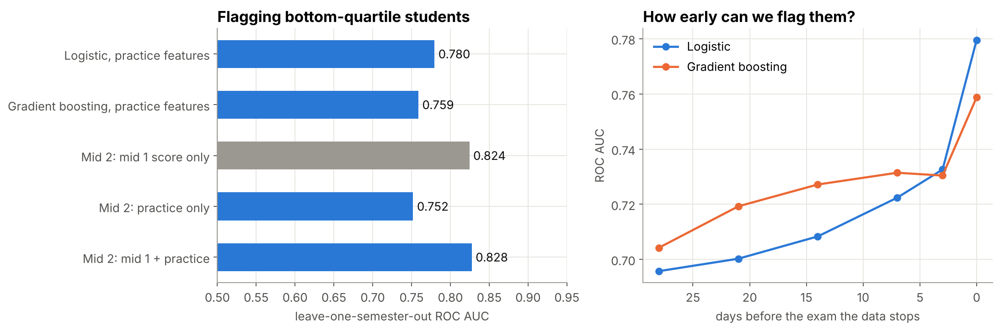
<em class="caption">Figure 10. Held-out-semester AUC by model, and how it falls as the data stops earlier before the exam.</em>

| Model | AUC | Avg. precision | Brier | Precision, top 10% |
|---|---|---|---|---|
| Logistic, all exams | 0.780 | 0.500 | 0.155 | 0.57 |
| Gradient boosting, all exams | 0.759 | 0.450 | 0.167 | 0.51 |
| Midterm 2: midterm 1 score only | 0.824 | 0.593 | 0.138 | 0.71 |
| Midterm 2: practice only | 0.752 | 0.444 | 0.166 | 0.51 |
| Midterm 2: midterm 1 + practice | 0.828 | 0.587 | 0.144 | 0.65 |

- Logistic regression matches or beats gradient boosting with the full data: with 10 features and about 2,400 training rows per fold, a nonlinear model has little to gain and more variance. Gradient boosting holds up slightly better at longer lead times.
- Parsons first-try success dominates the permutation importance (AUC drop 0.182, next feature 0.047).
- With only practice from at least 14 days before the exam, AUC is still 0.71 (logistic) and 0.73 (boosting): a usable early warning.
- For midterm 2, midterm 1 score alone reaches 0.82; adding practice gives 0.83. Practice data is most useful *before* the first exam, when nothing else is known.

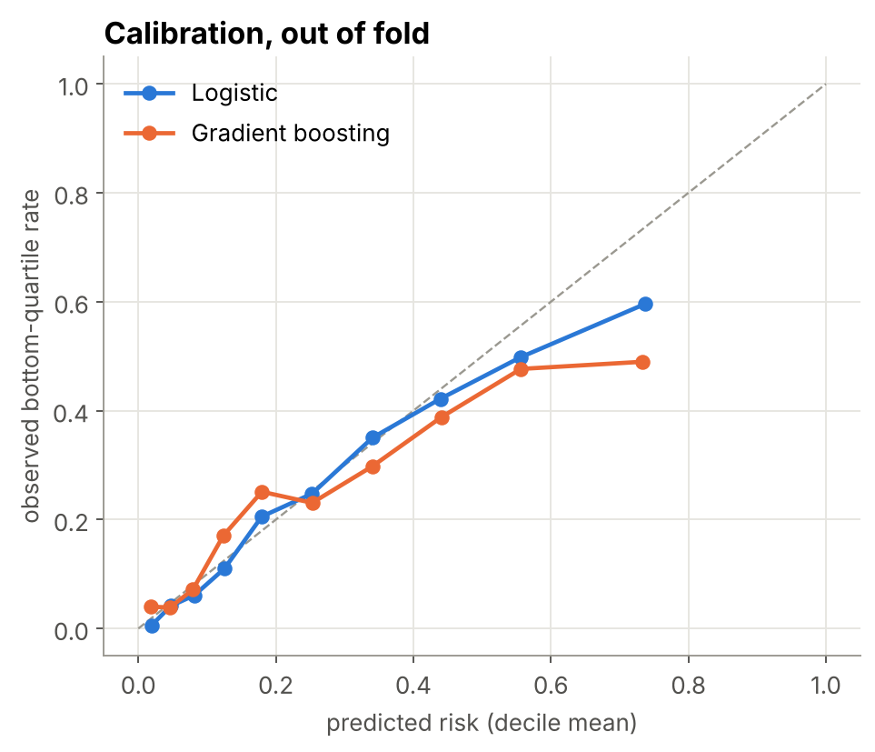
<em class="caption">Figure 11. Predicted vs observed risk by decile (out of fold).</em>

<h2 class="newpage" id="9-limitations">9. Limitations</h2>

- **Association, not causation.** Stronger students both solve Parsons problems on the first try and score well. Controlling for midterm 1 narrows this but doesn't remove it. A causal claim would need an experiment (e.g. randomizing Parsons assignments) or a credible natural experiment.
- **Reconstructed scores.** Scores are rebuilt from logs, not the gradebook. Short-answer items are excluded, and keyed items rely on inferred keys (tested in §8.3). Students who took an exam offline or on another device are missing.
- **Only logged practice.** Practice outside the ebook (lecture, office hours, other sites) is invisible.
- **One course, one platform.** Eight semesters of the same course; generalizing to other courses is untested.
- **No demographics or prior achievement** beyond midterm 1, because they were not part of the data shared.
- **Model use.** An at-risk flag should start a supportive conversation, not trigger penalties. Precision in the top 10% is about 57%, so roughly 43% of flagged students are not in the bottom quarter.

<h2 class="newpage" id="10-tool-choices">10. Tool choices, and what was rejected</h2>

| Tool | Used for | Why this and not something else |
|---|---|---|
| **uv** + `pyproject.toml` + `uv.lock` | environment | one command (`uv sync`) reproduces exact versions; much faster than pip/conda; optional extras keep the core install small |
| **DuckDB** | storage queries, SQL features | in-process SQL directly on parquet, no server; handles 19.8M rows on a laptop. Rejected: Postgres (a server to run for one analyst), BigQuery (would move student data to the cloud) |
| **Parquet** (zstd) | intermediate data | columnar, typed, about 10× smaller than CSV, readable by pandas and DuckDB |
| **pandas** | per-problem logic | first/last/best per problem is clearer in pandas than in SQL |
| **Pandera** | schema validation | declarative checks on DataFrames at each stage boundary |
| **statsmodels** | fixed-effects OLS, clustered SEs | standard inference output that scikit-learn doesn't provide |
| **scikit-learn** | models, CV, calibration, importance | `LeaveOneGroupOut`, pipelines that keep imputation and scaling inside each fold |
| **MLflow** | experiment tracking | every model run's parameters and metrics are kept and comparable in a UI |
| **Dagster** | orchestration | assets map one-to-one onto the stages, with lineage and selective re-runs. Rejected: Airflow (heavier, task-centric), dbt (would split the logic between SQL and Python) |
| **Jupyter notebooks** | readable execution record | the stakeholder data can't be published, so the executed notebooks are how anyone sees exactly what ran |
| **pytest**, **ruff**, **GitHub Actions** | quality | tests and lint on every push; the synthetic end-to-end test runs without the data |
| **Streamlit** + Plotly | dashboard | Python-only interactive app over the aggregate outputs |
| **Looker Studio** CSVs | stakeholder dashboards | aggregate tables the course staff can chart without Python |

Considered and skipped: **DVC** (raw data is fixed and checksummed by the manifest; DVC would add a remote for data we can't share), **dbt** (the SQL is nine files run by one function; dbt's value grows with many models and many contributors).

<h2 class="newpage" id="11-runbook">11. Runbook</h2>

### 11.1 First run on a new machine

```bash
git clone <repo> && cd so-ell
uv sync --all-extras            # Python 3.13, exact locked versions
# copy the semester folders into data/raw/ (see data/raw/README.md)
make test                       # unit + synthetic end-to-end tests (no data needed)
make notebooks                  # the full pipeline through notebooks 01-07, about 30-40 minutes, ~8 GB RAM peak
# or: uv run so-ell all         # same stages, headless
```

### 11.2 Everyday commands

| Command | Does |
|---|---|
| `make test` / `make lint` | tests / ruff |
| `uv run so-ell all --from features` | re-run from a stage onward |
| `make app` | Streamlit dashboard |
| `make mlflow` | MLflow UI on the logged model runs |
| `make dagster` | Dagster UI; materialize assets from there |
| `make pdf` | rebuild this PDF from `docs/design_report.md` |
| `uv run python notebooks/build_notebooks.py` | regenerate notebooks after editing their cells |

### 11.3 Adding a semester

1. Put the export(s) in `data/raw/<SEM>/` (one per section if split; the file name must contain `MW` or `TTh` for split sections).
2. `uv run so-ell manifest` to refresh checksums; commit `MANIFEST.csv`.
3. Add the code to `ANALYSIS_SEMESTERS` in `config.py`.
4. `make notebooks`. Check `exam_name_audit.csv` for new timed-exam names the rule might misclassify.

### 11.4 Changing a scoring rule or feature

Change the function in `src/so_ell/`, add or adjust a test, run `make test`, then `make notebooks` from the affected stage onward. Notebooks always show the current source, so they never need hand-editing for logic changes.

<h2 class="newpage" id="12-interview-questions">12. Questions you will be asked</h2>

**What was the project, in one sentence?**
Using 19.8 million ebook log events from eight semesters of an intro programming course, I rebuilt midterm scores from the logs, found that first-try success on Parsons code puzzles is the most robust practice signal of exam performance, and built an at-risk model validated on unseen semesters.

**Why rebuild the scores instead of using grades?**
Grades weren't shared. The midterms are taken in the ebook, so every answer is in the log; scoring them with explicit rules per item type and a sensitivity analysis on the one assumption (inferred keys) gives a score we can defend.

**How do you know the reconstructed scores are right?**
Rules mirror how the exam grades (last MC answer, best Parsons/ActiveCode). Inferred keys require 65% agreement. Short answer is excluded and reported. The synthetic end-to-end test checks exact expected scores. And the headline result is unchanged across key thresholds from 55% to none at all.

**What was the hardest bug?**
The id collision: two section exports both start numbering at 1, so different students merged into one. It didn't crash anything; it just quietly blended people. It shows up as the same local id starting the real midterm in both section files of one semester. Fix: namespace ids at ingest, enforce the format with a schema, and test it end to end.

**What is data leakage here, and how did you prevent it?**
Midterm 2 features originally included answers typed during midterm 1. Both feature engines now drop every event inside any exam window before applying the time cutoff, and a test plants exam answers and checks they don't appear. For models, leakage across semesters is prevented by leave-one-semester-out validation, with imputation and scaling fitted inside each fold.

**Why within-cohort comparisons?**
Exam difficulty differs a lot by semester. Pooling would largely measure the semester. Ranks, quartiles and fixed effects within semester × midterm compare each student only with classmates who took the same exam.

**Isn't this just "good students do well"?**
Partly, and the report says so. The test closest to separating them is midterm 2 controlling for midterm 1: among students with the same midterm 1 score, Parsons first-try success before midterm 2 still predicts midterm 2, with a smaller coefficient (1.6 vs 4.9 points per 10). That is consistent with some real effect of practice quality but doesn't prove it; an experiment would.

**Why cluster standard errors and bootstrap by student?**
Each student appears twice (two midterms). Treating the rows as independent overstates precision. Clustering and resampling students account for that.

**Why Benjamini–Hochberg?**
116 features were screened. At p < 0.05 about 6 would pass by chance even if none were related. BH controls the expected share of false discoveries among the features we call significant.

**Why logistic regression over gradient boosting?**
With 10 features and ~2,400 rows per training fold, logistic regression was as good or better held-out (AUC 0.78 vs 0.76), is calibrated, and its coefficients can be explained to instructors. Boosting is kept as a check for nonlinearity and does slightly better at long lead times.

**Why leave-one-semester-out?**
It is how the model would be used (train on past terms, score this term) and it tests transfer across exams and instructors. Random folds would mix students from the same semester into train and test and overstate accuracy.

**Why AUC and precision at 10%?**
AUC measures ranking regardless of threshold. Precision at 10% answers the operational question: if an instructor contacts the 10% most at-risk students, how many truly are? It was 57% vs a 25% base rate.

**How early can you flag students?**
Two weeks before the exam the AUC is 0.71 (logistic), from 0.78 on the day.

**What's the "gain paradox"?**
Improvement on Parsons correlates negatively with exam score because students who are right the first time can't improve. It's a ceiling effect: from the bottom to the top first-try quartile, gain falls from 0.71 to 0.39 while exam scores rise from 59 to 79.

**Why DuckDB rather than pandas for everything, or a database?**
DuckDB runs SQL directly on the parquet in-process, which is ideal for windowed counts over 19.8M rows on a laptop, with no server and no data leaving the machine. Per-problem first/last/best logic stayed in pandas, where it is clearer.

**Why Dagster and MLflow for a one-person analysis?**
Dagster makes the stage graph explicit and lets you re-run one stage and everything downstream; MLflow keeps every model run comparable instead of overwriting CSVs. Both are optional extras; the core pipeline runs without them.

**How is it reproducible if the data isn't public?**
Three ways. The executed notebooks show every line of code that ran and the aggregate result of each step. The manifest pins the exact input bytes, so anyone with data access gets identical results with `make notebooks` from a locked environment and fixed seed. And CI runs the full pipeline code on synthetic data that reproduces each data problem.

**What would you do next?**
Get gradebook scores to validate the reconstruction; add prior-course data to control for ability; a randomized nudge (e.g. recommending Parsons practice to flagged students) to test causality; knowledge-tracing models of per-concept mastery from the event sequence.

**What did you change from the original project?**
See §4 (five correctness fixes) and the move from loose scripts and CSVs to a package with tests, schemas, a checksummed manifest, notebooks as the execution record, and tracked models.

## Appendix A. Output tables

All in `outputs/tables/` unless noted; every one is aggregate.

| File | Contents |
|---|---|
| `cohort_score_summary.csv` | n, mean, median, sd of scores per cohort |
| `exam_window_summary.csv`, `exam_name_audit.csv` | attempts per exam; every timed-exam name and the keep/drop decision |
| `inferred_answer_keys.csv` | per keyed problem: support and confidence (keys removed) |
| `unscored_items_summary.csv` | items that couldn't be scored |
| `feature_signals.csv` | every feature: within-cohort correlation, quartile gap, p, q |
| `parsons_models.csv`, `parsons_gap_bootstrap.csv` | fixed-effects specs; bootstrap CI |
| `feature_quartile_scores.csv` | score by feature quartile by cohort |
| `change_signals.csv`, `parsons_change_groups.csv` | mid1→mid2 changes |
| `key_threshold_sensitivity.csv` | headline under each key threshold |
| `practice_timing_by_score_band.csv`, `cramming_*.csv` | timing of practice |
| `practice_exam_*.csv` | timed practice exams |
| `at_risk_*.csv` | model comparison, folds, importance, coefficients, calibration, lead time |
| `pipeline_funnel.csv`, `../headline_metrics.csv` | the funnel and every number quoted in §1 |
| `../data_quality/*.csv` | ingest row counts, event-log checks |
| `../looker_studio/*.csv` | tables for the Looker Studio dashboard |
